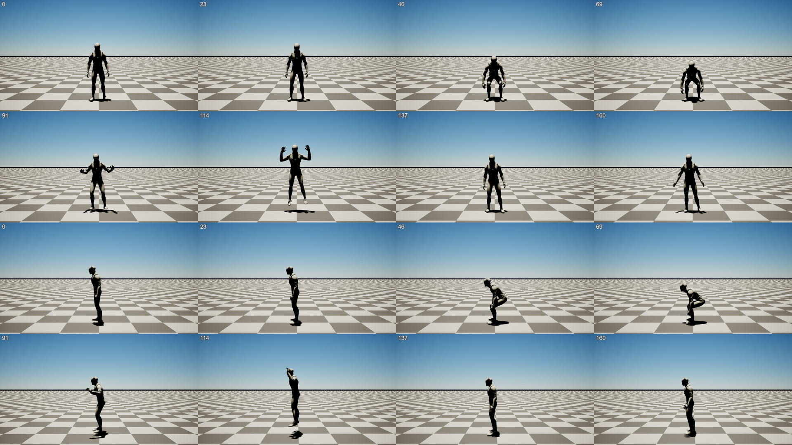
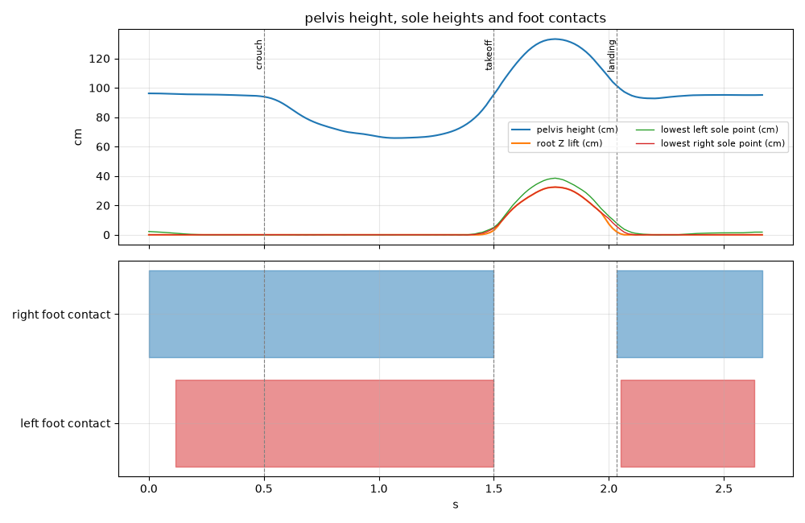

# Progress report: first overnight run (2026-11-09)

**Headline:** the MVP pipeline works end to end on your real clips. Your package (4 jump takes + the A-pose turn) goes through the Unreal plugin, the processor and back, and comes out as a 60 fps AnimSequence on Manny with root motion and an FBX. Manny crouches, leaves the floor for 0.55 s, lands, and stands. The feet stay planted while on the ground.



Video: [`media/2026-11-09_jump_preview.mp4`](media/2026-11-09_jump_preview.mp4) (front and side, 60 fps, rendered headless by the plugin).

The phone app is built and tested in code, but **nothing has run on a phone yet**. That is the first thing to do this morning.

## What works

| Piece | Status | How it was verified |
| --- | --- | --- |
| Processor (video → Manny motion) | Working | Your 5 clips; 22 pytest tests; debug plots reviewed |
| Unreal plugin: import, root motion, FBX | Working | Headless commandlets on UE 5.8; offscreen render reviewed frame by frame |
| Unreal plugin: Wi-Fi receiver, QR pairing, job queue | Working headless | curl and a Kotlin client against the real receiver: 83 MB package → `done` |
| Android app: capture, guidance, packaging | Builds, 68 unit tests pass | **Not run on a device** |
| Android app: QR pairing, Wi-Fi send, background service | Builds, integration test passes against the real receiver | **Not run on a device** |
| One-click processor install from the plugin | Script works; button untested in the UI | `setup_processor.ps1` dry run plus an idempotent re-run on this PC (12.9 s, doctor ok). It downloads ~7 GB on a fresh machine, which I didn't test |

Numbers from the final run on your package:
- Chosen take: `action_02` (Jump2). Takes 1–3 scored within 0.02 of each other, so the tie-break picked the longest airtime with a clean landing.
- Calibration from the A-pose turn: leg 0.80 m, height 1.71 m. Scaled ×1.064 to Manny.
- Trimmed to 2.7 s (161 frames at 60 fps), from the walk-in before the crouch through the settle after landing.
- Airtime 0.556 s → jump apex 35 cm (GEM-X alone said 16 cm; see "Decisions I made").
- Foot sliding while planted: 2.3 cm before cleanup, ~0 after. Retarget direction error vs the reconstruction: 0.76° mean.
- Time: about 70 s of GPU per take on the RTX 5070 (~4 GB VRAM). The whole package takes ~6 min because all 4 takes are reconstructed to pick the best.
- Quality verdict: `usable`, with one warning, `low_light` (your room averages 66/255 brightness).



## Decisions I made for you

1. **3D model: NVIDIA GEM-X with the SOMA body model.** It is the only strong video-to-3D-body model I found whose license and training data allow commercial use: code Apache-2.0, weights under the NVIDIA Open Model License ("ready for commercial use"), and training data documented as NVIDIA-owned or purchased mocap plus synthetic data. Everything built on SMPL/AMASS/Human3.6M is excluded. Meta's SAM 3D Body is the fallback.
2. **No YOLOX person detector.** GEM-X ships with a YOLOX model trained on HumanArt, whose data license is unclear. I swapped in MediaPipe (Apache-2.0) to find the person. This is done by a small runtime patch, so it is tied to the pinned GEM-X commit.
3. **Physics fixes the jump height.** GEM-X underestimates vertical motion from one camera. The flight phase is replaced by a ballistic arc whose duration is the measured airtime (apex = g·T²/8, capped at 80 cm). You can turn it off with `--no-ballistic`.
4. **Root motion follows the feet, not the hips.** During the crouch your hips move ~30 cm back. If the root followed them, the character's capsule would slide. Now the root stays under the planted feet and travels only during flight.
5. **Retargeting happens in the processor, not with Unreal's IK Retargeter.** The processor solves rotations directly for Manny's skeleton, and the plugin writes them straight into an AnimSequence. It is simpler and deterministic. Studios with their own characters use their existing Manny → character retargeter, which is the normal UE workflow.
6. **Unreal's mannequin is not committed.** Epic's content can't be redistributed in a public repo, so the README says to copy it from the engine install.
7. **Windows only, no WSL.** GEM-X documents only Linux, but it ran natively on Windows without patches.
8. **Package selection processes every take.** It is accurate but slow (~70 s per take). A faster pre-screen could come later.

## Needs your decision or action

1. **Test on the phones.** Install with `cd mobile && gradlew :androidApp:installDebug` (the Android SDK is now in `%LOCALAPPDATA%\Android\Sdk`). Watch for:
   - Whether 1080p really records at 60 fps on the Pixel 7.
   - Phone heat with live pose detection running.
   - The QR scan.
   - The Windows Firewall prompt the first time the plugin listens. Allow it on private networks.
   - Router "client isolation" on some Wi-Fi networks, which blocks phone-to-PC traffic.
2. **Guidance thresholds are untuned.** Light, contrast, framing and tilt limits are reasonable guesses (`GuidanceConfig.kt`). Your first real sessions will tell us where they nag too much or too little.
3. **Get the licenses reviewed before anyone ships with this.** The NVIDIA Open Model License allows commercial use with conditions. The GEM-X body checkpoint embeds a DINOv3 backbone under Meta's DINOv3 License, which I have not read. Have someone qualified review both.
4. **Recording tips for your setup.** Your clips work, but they're hard:
   - The camera sits near the floor and tilts up, and your head leaves the frame at the top of the jump in about a third of the frames.
   - The room is dim, and you're in dark clothes in front of a dark sofa.

   Phone at waist height, a bit farther back, and more light would help most.
5. **Open the editor once.** I only ran Unreal headless, so the **Tools → EspeonAnim → EspeonAnim Capture** tab (QR code, job list, buttons) has never been shown on screen. Tell me what looks off.

## Known limitations

- Only jumps are tuned. Trimming and the ballistic fix detect a jump, and other actions fall back to the whole clip with a warning.
- Body only: no fingers or face. Manny's twist and corrective bones keep their reference pose.
- The end pose is whatever you did after landing; it doesn't blend back to idle.
- iOS: the shared Kotlin code is iOS-ready, but the camera layer (Swift) hasn't been started. It needs your Mac.
- The CPU fallback (`--device cpu`) is wired up but untested.
- Phone IMU data and camera intrinsics are recorded in the package but the processor doesn't use them yet. Camera tilt from gravity would improve the floor estimate.

## Suggested next steps

1. A device test session with both Pixels, then tune the guidance thresholds.
2. Speed: pre-screen takes with MediaPipe and run GEM-X only on the best one or two (~6 min → ~2 min).
3. Use the phone's gravity vector for the floor plane and camera height warnings.
4. Blend in/out to an idle pose so the animation loops cleanly into a game's state machine.
5. The iOS camera layer in Swift on your Mac.
6. More actions: a run-up jump, then landing variants.

## Where things are

- Branch `dev`, with a pull request to `main` for your review. Nothing is merged.
- Your test clips are in `testdata/raw/` (not in git). Processor outputs are in `processor/out/` (not in git).
- Headless commands for a quick check:
  ```
  UnrealEditor-Cmd.exe EspeonAnim.uproject -run=EspeonProcess -Input=<package or video>
  UnrealEditor-Cmd.exe EspeonAnim.uproject -run=EspeonRenderPreview -Anim=/Game/EspeonAnim/Animations/<name> -Out=<folder> -AllowCommandletRendering -RenderOffscreen
  ```
